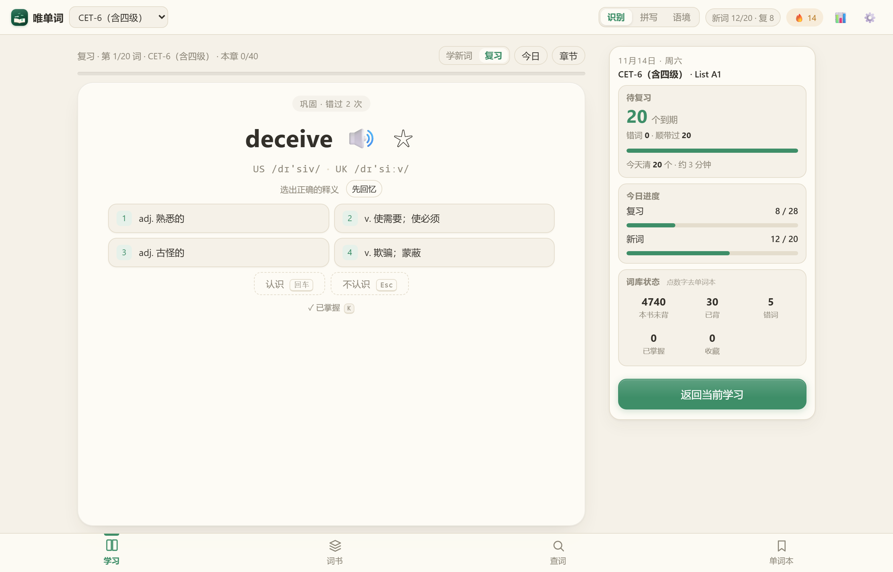
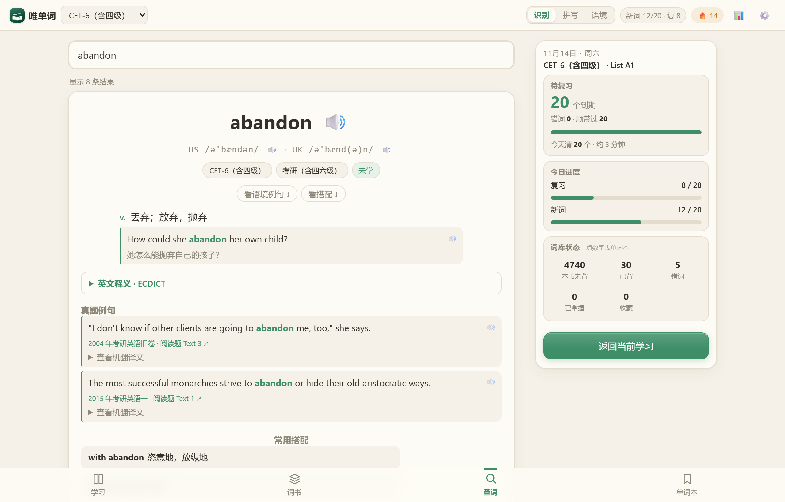
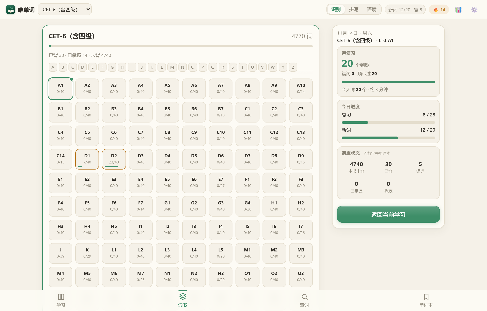
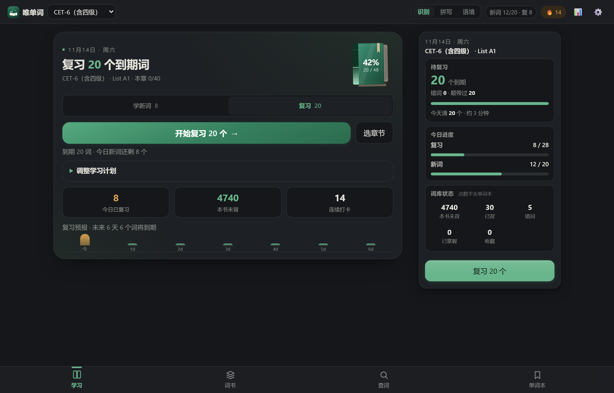
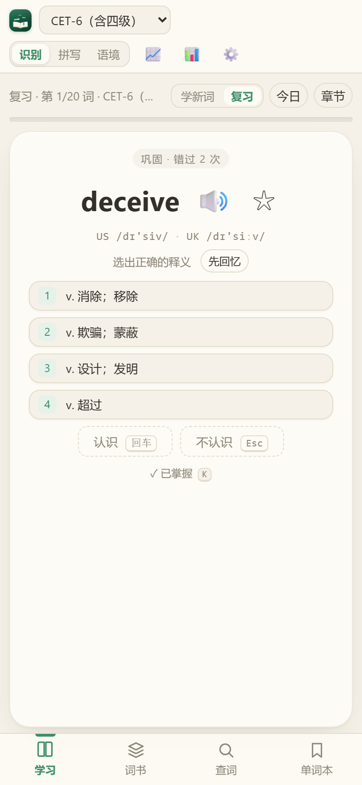
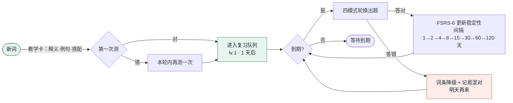

<div align="center">


**键盘流背单词。一义一例，真题作证，记忆曲线兜底。**

[🌐 线上直接用](https://vocab-drill-12129.app.workbuddy.host/?sharecode=46MZWZWZMD) ·
[📦 单文件版](#三种打开方式) ·
[🧠 它和别的背词软件哪里不一样](#为什么它不一样) ·
[⌨️ 快捷键](#键盘就是全部操作)

</div>

---

## 它是什么

一个**纯前端、零依赖、零构建**的背单词单页应用。打开就能背，不用登录、不用安装、不用等加载。

背的是**六级 / 考研**的考纲词，但释义、搭配、例句、真题出处是按「考场上要认出这个词」的标准重做的 —— 不是从词典里搬一条中文过来。

<table>
<tr>
<td width="50%">
<p><b>不联网也能背完一整本</b><br>
Service Worker 把外壳和词库都缓存到本地。断网、飞行模式、地铁里，一样能刷。</p>
</td>
<td width="50%">
<p><b>手机电脑共用一份进度</b><br>
同一个账号登录，电脑上背到第 30 个，手机打开就是第 30 个，不是各自为战。</p>
</td>
</tr>
<tr>
<td width="50%">
<p><b>双击一个 HTML 文件就能用</b><br>
20 MB 的单文件版把词库、字典、真题全塞进一个 <code>.html</code>，拷到没网的电脑上照样查任何词。</p>
</td>
<td width="50%">
<p><b>键盘就是全部操作</b><br>
<code>1-4</code> 选答案、<code>回车</code> 认识、<code>Esc</code> 不认识、<code>空格</code> 下一个。手不离键盘，眼不离词。</p>
</td>
</tr>
</table>

## 看一眼


<div align="center"><sub><b>今日任务台</b> —— 背新词和复习是两条独立任务线，各自记住当天进度；右边的书脊就是今日完成度</sub></div>

<table>
<tr>
<td width="50%"></td>
<td width="50%"></td>
</tr>
<tr>
<td align="center"><sub><b>识别卡</b> · 先回忆，再四选一；答完才给释义和例句</sub></td>
<td align="center"><sub><b>查词卡</b> · 真题例句带年份和题型，一路可点到原文</sub></td>
</tr>
</table>

<table>
<tr>
<td width="50%"></td>
<td width="50%"></td>
</tr>
<tr>
<td align="center"><sub><b>章节网格</b> · 按首字母切 200 多个 List，缺哪块一眼看得出</sub></td>
<td align="center"><sub><b>深色主题</b> · 不是反色，是重新配的一套颜色</sub></td>
</tr>
</table>

<div align="center">

<br><sub><b>手机端</b> · 单列布局，拇指够得到所有按钮；可添加到主屏幕当原生 App 用</sub>
</div>

## 为什么它不一样

|  | 常见背词 App | 唯单词 |
|---|---|---|
| **释义** | 一条中文，多义堆在一起 | **只给考场上真正会考的那 1–2 个义项**，一义配一例 |
| **例句** | 词典例句，或 AI 生成 | **真实真题原句**：15,250 条，标年份 / 题型 / 文章，例句后紧跟中文 |
| **练习** | 一个模式刷到底 | 识别 → 拼写 → 语境 → 听写，**四种练法分开记分**，弱在哪补哪 |
| **复习** | 固定「1 天 / 3 天 / 7 天」 | **FSRS-6**：按你自己的答对率、反应速度、提示依赖程度调间隔 |
| **答错** | 从头再来一遍 | 本轮内**再测一次**（轮次巩固）+ 答错的选项**记进易混对**，下次专门辨析 |
| **顺序** | 只能按词书顺序 | **顺序 / 乱序可切换**：乱序从全书随机抽，防「靠位置记词」 |
| **数据** | 锁在云端，导出要付费 | 本地优先，任意时刻**导出 JSON**；云端只是备份，冲突按「数据改动时间」判定 |

<details>
<summary><b>几个不太显眼但很实用的细节</b></summary>

- **先认识，再考试**：新词先出「教学卡」（大字 + 音标 + 一义一例 + 短语 + 近义词），认完再测，不拿陌生词考你。
- **认识 / 不认识自评**：识别卡可以先回忆再揭晓；答不上来按 `Esc` 直接跳过，不浪费一次错答。
- **词根词缀**：答完自动拆分，如 `com·prehend·sion`，并给词根释义 —— **拆不出来就不显示**，绝不编词源。
- **易混辨析**：你选了哪个错的释义，系统就记住是哪个词的释义在干扰你，攒成「易混对」。
- **顽固词**：同一个词错 4 次以上会被单独捞出来攻坚，而不是每轮都来捣乱。
- **已掌握**：真记住了可以标记「不再复习」，永久移出队列。
- **进度导出 / 导入**：换设备、换浏览器，一个 JSON 全带走。
- **发音**：走有道在线音频（美音 / 英音可选），不是浏览器合成音。

</details>

## 记忆是怎么排的



调度器是 **FSRS-6**（`js/vendor/fsrs.global.js`，22 KB）。每个词记着稳定性和难度，`目标记忆率` 可调（80% 省时 / 95% 最牢）。参数变了会重建调度器，但历史评分不丢。

## 三种打开方式

### 1. 线上直接用（推荐）

```
https://vocab-drill-12129.app.workbuddy.host/?sharecode=46MZWZWZMD
```

手机浏览器打开 →「添加到主屏幕」，之后就是一个独立图标，断网也能用。账号登录后可跨设备同步。

### 2. 单文件版：拷给任何人

```bash
node tools/build_standalone.mjs     # 生成 唯单词.html（20 MB，零外链）
```

双击即用。词库、9.8 万词字典、真题例句全在里面，**没有一行外部请求**（发音除外，那个本来就要联网）。

### 3. 本地起服务

```bash
python -m http.server 8651 --bind 127.0.0.1
# 打开 http://127.0.0.1:8651/index.html
```

## 键盘就是全部操作

| 键 | 作用 | 键 | 作用 |
|---|---|---|---|
| `1` `2` `3` `4` | 选第 1–4 个选项 | `空格` | 下一个 |
| `回车` | 认识 / 提交 | `Esc` | 不认识 / 关闭 |
| `←` | 上一个词 | `K` | 标记已掌握 |
| `Q` | 看详细词条 | `P` | 发音 |
| `S` | 收藏 | `?` | 全部快捷键 |

## 数据打哪来

| 数据 | 规模 | 来源 |
|---|---|---|
| CET-6 / 考研词书 | 4,770 / 5,091 词 | 考纲词表，逐词重做释义、搭配、近义词 |
| 通用字典 | 98,159 词 | ECDICT 开源词库，按需懒加载，**永不进背诵队列** |
| 真题例句 | 15,250 条 / 8,313 词 | 2015–2026 六级、1998–2026 考研真题原文，按原句精确回填中文 |
| 词根词缀 | 覆盖 43.6% | 人工整理的词根表，拆不出就不显示 |

> 真题文本仅用于个人学习与研究，版权归原出版方所有。若权利人提出异议会立即移除对应内容。

## 技术

```
index.html          210 行，全部结构
css/style.css     3,000 行，无框架，CSS 变量做主题
js/app.js         6,600 行，全部逻辑（无构建、无打包、无依赖）
data/*.js         20 MB 词库，纯 JSON 赋值，按需 <script> 懒加载
sw.js             Service Worker：外壳预缓存 + 词库 stale-while-revalidate
```

- **没有 npm、没有 webpack、没有 TypeScript 编译**：改完刷新就是最新的，`node --check` 就是全部构建步骤。
- **主题**用 CSS 变量 + `prefers-color-scheme`，深色不是反色，是重新配的一套颜色。
- **单文件版**由 `tools/build_standalone.mjs` 把 CSS / JS / 数据全部内联，并断言「零外链 · script 标签成对」。
- 架构细节见 [docs/ARCHITECTURE.md](docs/ARCHITECTURE.md)。

## 体检

全部零依赖：Node 22 内建 WebSocket 直连本机 Edge 的 CDP，不装 Playwright、不下载浏览器。

```bash
python -m http.server 8651 --bind 127.0.0.1 &
node tools/smoke.mjs "http://127.0.0.1:8651/index.html"   # 113 项主回归
node tools/probe-v5.mjs   "http://127.0.0.1:8651/index.html"   # 39 项
node tools/probe-order.mjs                                  # 18 项：顺序 / 乱序
node tools/probe-cloudsdk.mjs                               #  8 项：云 SDK 加载链
```

| 脚本 | 项数 | 覆盖 |
|---|---|---|
| `smoke.mjs` | 113 / 108 | 主回归：封面、四选一、答后闸门、回溯、教学卡、SW、离线重载 |
| `probe-v5.mjs` | 39 | 听写、技能画像、记忆曲线、例句朗读、版本断言 |
| `probe-order.mjs` | 18 | 顺序 / 乱序切换、随机性、复习集合不变性 |
| `probe-welcome.mjs` | 14 | 首启导览：分组、32 项功能覆盖、手机尺寸、深色 |
| `probe-voice.mjs` | 17 | 有道音频能播、连点复用、断网失败 |
| `probe-cloudsdk.mjs` | 8 | 云端 SDK 自托管命中 + CDN 兜底 |
| `card-fit.mjs` / `hero-fit.mjs` | 6 / 5 档 | 1440→390 宽逐档验证一屏装下 |

## Roadmap

- [x] FSRS-6 调度 + 轮次巩固
- [x] 四种练法分技能画像
- [x] 真题例句与出处
- [x] 云同步（按数据改动时间判定冲突）
- [x] 顺序 / 乱序可切换
- [ ] 随机组卷模拟考
- [ ] 词根树形图谱可视化
- [ ] 生词本导出 Anki 牌组

## 许可

代码 MIT。`data/` 下的词库与真题文本仅用于学习研究，版权归原权利人。
